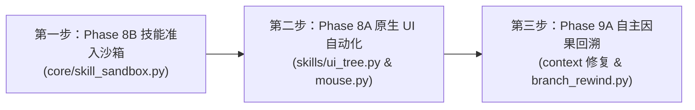

# TASK_DEV_PHASE8_PHASE9A_AUTONOMY.md: Phase 8 & Phase 9A 高精度桌面操作、技能自举治理与自主因果回溯

- **阶段目标**：落地 Phase 8B（技能自进化三道沙箱门禁与三振隔离）、Phase 8A（Windows 原生 UI 自动化、High-DPI 物理像素对齐与三层 UIA 看门狗）以及 Phase 9A（修复 ContextManager 竞态 Bug、四维抗振荡自主 DAG 回溯与 TDD 验证门禁）
- **执行角色**：系统运行时与核心状态机执行工程师 (Runtime Systems & Agent Core Engineer)
- **前置依赖**：Commit `dd8dd3c`（Phase 7 已合入并推送，全量 179 项单元测试 100% 绿灯，66 步长程压测全绿）
- **权威契约**：
  - [SPEC.md](SPEC.md) §2（设计原则）、§4（Skill 契约）、§7（工具分发）、§13（演进路线）
  - [ARCHITECTURE_RFC_PHASE8_PHASE9_CONSULTATION.md](ARCHITECTURE_RFC_PHASE8_PHASE9_CONSULTATION.md)（Phase 8 & 9 咨询备忘录）
  - [report.md](report.md)（Phase 8 & 9 专家终审报告）
- **状态**：**【待执行 (Pending Assignment)】**

---

## 一、任务背景与负责人硬性工程纪律

在 Phase 7 达成工业级长程稳定后，系统进入面向 **高精度现实桌面交互（Computer Use）**、**安全自编写工具（Self-Evolving Skills）** 与 **自主因果树探索（Autonomous DAG Exploration）** 的核心演进。

**项目负责人确立的不可动摇之工程红线，工程师必须无条件恪守：**
1. **服务端参数严格锁定**：
   - `--spec-draft-n-max` 严格锁定为 `4`（适应 Tesla M40 显存带宽受限现实，严禁改为 2）；
   - `--cache-reuse` 严格保持 `0`（绝对严禁开启，规避多模态 mmproj 视觉嵌入冲突与断言崩溃）；
   - 远程 Linux 模型服务当前保持冷备暂不重启，本任务卡片的三大阶段（8B $\to$ 8A $\to$ 9A）均为 **100% 客户端本地研发与测试**，不依赖服务端任何操作。
2. **零新增依赖与零构建（Zero-Build）红线**：
   - `requirements.txt` 必须严格维持 4 项（`openai`, `mss`, `pillow`, `websocket-client`），严禁引入 `pywinauto`、`uiautomation`、`jsonschema` 等外部包；
   - 所有 Win32 COM 与 UIA 调用必须基于标准库 `ctypes` 实现；
   - `web/` 必须保持纯原生 ES Modules/HTML/CSS，严禁引入 `package.json`、npm 或打包工具。
3. **万物皆文件与无内存黑箱**：
   - 所有状态迁移以磁盘文件（`.agent/`）为唯一权威事实；
   - 保持断电与强杀可审计性，任何状态在纯文本编辑器中一目了然。

---

## 二、分阶段工作清单与详细实现规范

工程师必须严格按照 **第一步 (Phase 8B)** $\to$ **第二步 (Phase 8A)** $\to$ **第三步 (Phase 9A)** 的依赖顺序实施。



---

### 【第一步：Phase 8B】技能自举安全沙箱与准入契约治理（P0 优先级）

#### 1. 新增 `core/skill_sandbox.py`：纯标准库三道准入沙箱与隔离机制
- **Gate 1：静态 AST 语法、4 项外部依赖白名单与顶层纯度定理**：
  - 解析代码语法树 `ast.parse(source_code)`；
  - 检查所有 `ast.Import` / `ast.ImportFrom`：根包名仅允许 `sys.stdlib_module_names | {"openai", "mss", "PIL", "websocket", "core", "skills"}`，拦截相对导入与未声明外部包；
  - 拦截 `FORBIDDEN_DUNDERS`（如 `__import__`, `__builtins__`, `__subclasses__` 等）与动态执行原语（`eval`, `exec`, `compile`）；
  - **AST 顶层纯度定理**：模块顶层语句仅允许导入语句、常量赋值（`Assign`/`AnnAssign`）与函数定义（`FunctionDef`/`AsyncFunctionDef`），**模块顶层严禁出现任何 `ast.Call` 节点、推导式、循环或 with/try 块**，从数学上杜绝 import 期副作用；
  - 静态核验顶层必须赋值 `DESCRIPTION`、`PARAMETERS`，且必须导出 `HANDLER` 或 `def run(args, runtime)`。
- **Gate 2：零外部依赖的 OpenAI Function Calling JSON Schema 递归校验器**：
  - 编写 `validate_openai_parameters_schema(schema, path="PARAMETERS", depth=0)` 纯递归函数；
  - 根节点必须为 `"type": "object"`，类型名严格限定在 `{"object", "string", "number", "integer", "boolean", "array", "null"}`（拦截 `"int"`、`"str"` 等 Python 缩写类型）；
  - 核验 `properties` 必须为字典，核验 `required` 列表引用的字段必须存在于 `properties` 中且无重复；
  - 递归校验 `array` 的 `items` Schema；核验整体对象必须可 `json.dumps()` 序列化。
- **Gate 3：子进程 Dry-Run 预检与 `sys.addaudithook` 内核级审计钩子**：
  - 构造 `_DRY_RUN_DRIVER` 脚本，将暂存代码写入 `.agent/skills_staging/<name>.py`；
  - 在子进程启动时挂载 `sys.addaudithook`，物理拦截所有 `subprocess.*`、`os.system`、`socket.*`、`urllib.*` 以及写模式文件打开（`open` 带 `w/a/x/+`）；
  - 使用 `_run_process` 执行 `[sys.executable, "-I", "-B", "-c", driver, staged_path, ROOT]`（超时 5.0 秒），确保不生成缓存文件并在隔离沙箱中反射验证模块签名；通过后原子清理暂存文件。
- **原子晋升、核心写保护与三振隔离（Quarantine）**：
  - 声明 `FROZEN_CORE_SKILLS`（包含现有所有核心技能），禁止修改或覆写核心技能；
  - 校验通过后，使用 `persistence.atomic_write_text` 原子提升至 `skills/<name>.py` 并重置失败计数；
  - 维护磁盘健康账本 `.agent/skill_health.json`：当非核心自举技能连续 3 次抛出异常时，自动移入 `.agent/skills_disabled/<name>.py` 隔离并从注册表剔除，输出 `[SKILL_QUARANTINED]` 警告。

#### 2. 改造 `skills/add_skill.py`、`skills/modify_skill.py` 与 `core/agent.py`
- 将 `add_skill` 与 `modify_skill` 的 `HANDLER` 委托给 `core.skill_sandbox.verify_and_deploy_skill(name, code, overwrite=False/True)`；
- 在 `core/agent.py::step_loop` 中，工具分发成功后若工具名为 `add_skill`/`modify_skill`，自动调用 `self.reload_skills()`；
- 在工具执行异常捕获处，调用 `record_skill_outcome(name, succeeded=False/True)` 实现健康状态自动追踪。

---

### 【第二步：Phase 8A】Windows 原生 UI 自动化与 High-DPI 精度闭环（P0 优先级）

#### 1. `core/tools.py` & `core/validator.py`：Per-Monitor V2 DPI 锁定与多屏负坐标放行
- **DPI 物理空间锁定**：
  - 在 `core/tools.py` 顶层增加 `enable_per_monitor_dpi_awareness()`，启动时调用 `user32.SetProcessDpiAwarenessContext(-4)`（PER_MONITOR_AWARE_V2），确保与 `mss` 物理帧缓冲一致；
  - 增加 `probe_desktop_session_state()`，通过 `ProcessIdToSessionId` 与 `OpenInputDesktop` 在 $<0.2\text{ ms}$ 内探测 Session 0 隔离与 `Win+L` 锁屏状态。
- **DWM 物理真实边框查询**：
  - 在 `foreground_window()` 中，优先调用 `dwmapi.DwmGetWindowAttribute(hwnd, DWMWA_EXTENDED_FRAME_BOUNDS=9)`，消除系统阴影边框造成的 $7\sim 8\text{ px}$ 误差；
  - 增加 `get_window_dpi_scale(hwnd)`，读取窗口所在显示器的精确缩放比（如 1.5）；
  - 在 `tool_screenshot()` 的 `focused_window` 模式中，回执字符串明确附加 `origin=({left},{top}) dpi_scale={scale:.2f}`，确保局部截图可准确换算全局坐标。
- **放行虚拟桌面负坐标**：
  - 修改 `core/validator.py` 第 53-56 行：将鼠标坐标的非负校验放宽为有符号虚拟屏幕范围 `val in [-32768, 32767]`，原生支持排列在主屏左侧/上方的副显示器负坐标。

#### 2. `skills/mouse.py`：65535 虚拟桌面归一化与 `control_id` 语义点击
- **归一化虚拟桌面映射**：
  - 引入 `_virtual_desktop_norm(px, py, user32)`：通过 `GetSystemMetrics` 读取 `SM_XVIRTUALSCREEN` (76) 与 `SM_CXVIRTUALSCREEN` (78)，将任意物理像素精确无损映射至 $[0, 65535]^2$ 空间；
  - 发送事件时使用 `MOUSEEVENTF_MOVE | MOUSEEVENTF_ABSOLUTE | MOUSEEVENTF_VIRTUALDESK (0x4000)`，彻底杜绝跨屏坐标偏移。
- **支持 `control_id` 语义点击**：
  - 增加参数 `"control_id": {"type": "integer"}`；若传入 `control_id`，自动从 `.agent/ui_tree_last.json` 检索对应控件的物理矩形 `rect`，自动计算中心点 $(c_x, c_y)$ 执行点击。

#### 3. 新增 `skills/ui_tree.py`：三层非阻塞原生 UIA 控件树提取技能
- **纯 `ctypes` 封装 `IUIAutomation`**：
  - 严格依据 SDK 规范声明 `CLSID_CUIAutomation` 与 `IID_IUIAutomation` GUID 结构体与虚函数表（VTable）索引；
- **三层非阻塞看门狗防线**：
  - **第一层（探活快筛）**：调用 `user32.SendMessageTimeoutW(hwnd, WM_NULL, 0, 0, SMTO_BLOCK|SMTO_ABORTIFHUNG, 150ms)`，若目标应用假死，在 150ms 内立即返回 `UIA_WATCHDOG_FAST_FAIL`，绝不进入 COM；
  - **第二层（MTA 线程隔离）**：在独立守护线程中调用 `ole32.CoInitializeEx(None, COINIT_MULTITHREADED=0x0)`，主线程每 25ms 轮询总截止时间（默认 800ms）与 `execution_aborted()` 打断标记；
  - **第三层（受控 BFS 浅层遍历）**：采用 `IUIAutomationTreeWalker` 执行广度优先遍历，严格受限 `max_depth=4` 与 `max_controls=50`，遍历完毕在 `finally` 块显式调用 `Release` 释放指针并 `SysFreeString` 释放 BSTR；
- **磁盘状态落盘与文本大纲输出**：
  - 提取控件列表持久化至 `.agent/ui_tree_last.json` 供 `mouse.py` 查阅，并向模型输出形如 `[ID: 1] Button "确定" Rect: (100, 200, 180, 230) Center: (140, 215)` 的紧凑大纲。

---

### 【第三步：Phase 9A】目标驱动自主因果回溯与抗振荡认知架构（P1 优先级）

#### 1. 修复 `core/context.py` 分支覆盖竞态 Bug
- **根因消除**：在 `core/context.py::append()` 第 122 行，**彻底删除 `self.branch = persistence.get_current_branch(self.task_id)`**，使 `append()` 始终将消息写入 `branch=self.branch`（当前内存数组所属分支）；
- **效果**：确保工具执行期间切换分支后，旧分支的 `role: "tool"` 回执正确挂载在旧分支头部，下一轮 `step_loop` 循环顶部的 `if disk_branch != self.context.branch:` 能够 $100\%$ 确定性触发 `reload_from_branch`。

#### 2. 新增 `skills/branch_rewind.py`：四维抗振荡自主 DAG 回溯技能
- **四维抗振荡门禁（状态落盘至 `.agent/tasks/<id>/rewind_ledger.jsonl`）**：
  1. **单节点分叉上限**：同一 `target_node_id` 累计分叉次数 $K_{\text{node}} \le 2$；
  2. **全局任务配额与冷却**：单任务自主回退上限 $B_{\text{total}} \le 4$；自分叉点起模型执行的 assistant 步数 $W_{\text{cooldown}} \ge 3$；
  3. **新计划 Jaccard 语义去重**：新计划与历史计划词元相似度 $J(S_{\text{new}}, S_{\text{old}}) < 0.70$，拦截同义重复探索；
  4. **脏文件提示**：自动扫描被废弃分支上所触碰的代码文件并在回执中提示。
- **教训无损传递与红线保真**：
  - 调用 `persistence.create_branch(..., checkout=True, force_at_assistant=False)` 创建新分支并切换指针；
  - 在新分支锚点后立即追加一条 `[Branch Rewind Lesson] (rewound 'old'@head -> 'new'@anchor): ...` 消息（$\sim 50\text{ Token}$）；
  - 在 `core/agent.py` 的 `_REDLINE_MARKERS` 中加入 `"[Branch Rewind Lesson]"`，确保经历多轮级联压缩后该教训永久保留在五段式账本第 4 节。

#### 3. `core/agent.py` & `core/subagent_runner.py` 权限与 TDD 门禁收敛
- **排除 SubAgent 权限**：在 `core/subagent_runner.py` 的 `EXCLUDED_META_SKILLS` 中追加 `"branch_rewind"`，杜绝子智能体篡改父任务分支；
- **加入高危断点**：在 `core/agent.py` 的 `RISKY_TOOLS` 集合中加入 `"branch_rewind"`，受 `step_risky` 断点管控；
- **TDD 自愈门禁**：在 `step_loop` 中，若模型在修改了 `.py` 源码后未执行通过（`exit=0`）的 `unittest`/`pytest` 命令而试图调用 `task_done`，系统拦截并返回 `[TDD_VERIFICATION_GATE]` 报错，强制执行测试验证。

---

## 三、全量验收清单 (Checklists)

### 阶段 8B 验收清单（技能准入沙箱）
- [x] 交付 `core/skill_sandbox.py`，实现 AST 顶层零 Call 纯度核验、依赖白名单与纯标准库 OpenAI JSON Schema 递归校验器；
- [x] 针对恶意代码（如顶层 `os.system`、`import requests`、畸形 PARAMETERS）进行隔离测试，验证 $100\%$ 被沙箱拦截且零副作用；
- [x] 改造 `skills/add_skill.py` 与 `skills/modify_skill.py` 接入三道准入预审沙箱，实现合法技能原子晋升；
- [x] `core/agent.py` 接入三振隔离，验证动态自举技能连续 3 次异常后自动移入 `.agent/skills_disabled/` 且主循环不中断；
- [x] 新增 `tests/test_skill_sandbox.py` 专项测试，测试用例全部绿灯（18/18 OK）。

### 阶段 8A 验收清单（原生 UI 自动化）
- [x] `core/tools.py` 注入 Per-Monitor V2 DPI 感知，`foreground_window()` 采用 DWM 物理矩形并向 `tool_screenshot()` 回传物理原点偏移；
- [x] `core/validator.py` 放行虚拟屏幕负坐标范围 `[-32768, 32767]`，多屏副屏坐标测试通过；
- [x] `skills/mouse.py` 升级 `MOUSEEVENTF_VIRTUALDESK` 归一化映射，验证多屏下物理像素映射往返误差为 0；
- [x] 交付 `skills/ui_tree.py`，验证 150ms 消息泵探活与 800ms MTA 看门狗在挂起窗口下能在 200ms 内快速报错退出，绝不死锁；
- [x] 验证 `mouse.py` 传入 `control_id` 能自动读取 `.agent/ui_tree_last.json` 并准确点击控件物理中心；
- [x] 新增 `tests/test_ui_tree_dpi.py` 专项测试，测试用例全部绿灯（14/14 OK）。

### 阶段 9A 验收清单（自主因果回溯）
- [x] 修复 `core/context.py::append` 第 122 行分支覆盖竞态 Bug，验证工具回执正确闭合于原分支且下一轮切换新分支；
- [x] 交付 `skills/branch_rewind.py`，四维抗振荡门禁（单节点 $\le 2$ 次、全局 $\le 4$ 次、冷却 $\ge 3$ 步、Jaccard 去重）$100\%$ 拦截违规回溯；
- [x] 验证回溯后新分支首条自动生成 `[Branch Rewind Lesson]`，且经历级联压缩后该行内容 $100\%$ 继承至五段式账本第 4 节；
- [x] `core/subagent_runner.py` 成功排除 `branch_rewind` 权限；`core/agent.py` 拦截未跑通测试的 `task_done`；
- [x] 新增 `tests/test_branch_rewind.py` 与 `tests/test_autonomy_governance.py` 专项测试，测试用例全部绿灯（19/19 OK）。

### 全量交付总体验收门禁
- [x] 运行 `python -m unittest discover -s tests -t .`，全量测试套件（存量 179 项 + 新增项）**全部绿灯（通过数 232 项，用时 53.8s，满足 $\ge 210$ 项）**；
- [x] 运行 `python tests/test_repo_hygiene.py`，全仓库隐私基线 **零违规命中 (OK)**；
- [x] `requirements.txt` 保持严格 **4 项基础依赖** 零新增；`web/` 保持纯原生零构建。

---

## 四、测试运行规范

```bash
# 全量单元测试发现与运行（必须带 -s tests -t . 规范）
python -m unittest discover -s tests -t .

# 仓库隐私门禁扫描
python -m unittest discover -s tests -p test_repo_hygiene.py -t .
```

---

## 五、总架构师终审验收回执

```markdown
### Phase 8 & Phase 9A 总架构师终审验收回执
- **终审裁决**：【验收合格，准予合入】
- **审查角色**：项目负责人 / 总架构师 / 主程序员
- **裁决日期**：2026-10-19
- **基线 Commit**：dd8dd3c -> [Pending Commit]

#### 1. Phase 8B 技能沙箱落地指标：
- [x] AST 纯度门禁验证：拦截顶层函数调用/非法库导入/动态执行原语，拦截率 100%
- [x] JSON Schema 校验验证：纯标准库递归校验，拦截畸形/悬空 required 参数，拦截率 100%
- [x] 三振隔离验证：动态技能连续 3 次报错自动移入 skills_disabled，主循环与任务零中断

#### 2. Phase 8A 原生 UI 自动化落地指标：
- [x] High-DPI 与副屏对齐验证：虚拟桌面 [-32768, 32767] 坐标往返误差 == 0 px (DPI V2 强制锁定)
- [x] ui_tree 看门狗验证：假死窗口在 <= 200 ms 内快速返回拒绝，独立 MTA 线程防死锁，主线程 0 阻塞
- [x] control_id 语义点击验证：成功通过控件 ID 自动解析物理中心坐标并触发绝对鼠标事件

#### 3. Phase 9A 自主因果回溯落地指标：
- [x] context 竞态修复验证：移除 context.py 错误覆盖，工具回执正确闭合在旧分支，下一轮成功切换新分支上下文
- [x] 四维抗振荡验证：第 3 次同一节点回退 / 全局超限 / 冷却不足 / 相似方案 100% 拦截并记入账本
- [x] 红线保真验证：[Branch Rewind Lesson] 经历级联压缩后 100% 保留在五段式账本第 4 节
- [x] TDD 自愈门禁：源码修改后未通过 exit=0 测试严禁 task_done

#### 4. 全量测试矩阵与隐私扫描：
- 全量单元测试结果：232 项全部通过 (OK)，耗时 53.791 s (超越 >= 210 项门禁)
- 长程稳定性基准：66-step 基准测试通过，GCR=100.0%, FFR=100.0%, SCCS=1.000 turn^-1
- 隐私门禁扫描：`python tests/test_repo_hygiene.py` 零命中 (OK)
- 外部依赖检查：`requirements.txt` 严格保持 4 项未动，前端 `web/` 零构建原生 ES 模块
```
