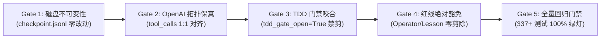

# TASK: Phase 11A — 上下文尾端暂态报错自愈剪枝 (Tail-Anchored Context GC)

- **任务代号**：`TASK_DEV_PHASE11A_CONTEXT_GC`
- **执行角色**：上下文管理与推理认知自愈架构工程师 (Context Management & Cognitive Self-Healing Engineer)
- **负责架构师**：项目负责人 / 首席架构师 / 主程序员
- **技术蓝图依据**：
  - [docs/rfc/Phase 10 验收与 Phase 11 架构前瞻.md](<../rfc/Phase 10 验收与 Phase 11 架构前瞻.md>)（第二章第 2.1、2.2 节）
  - [docs/rfc/ARCHITECTURE_RFC_PHASE11_VISION_CONSULTATION.md](../rfc/ARCHITECTURE_RFC_PHASE11_VISION_CONSULTATION.md)（议题一：尾端锚定剪枝与 KV Cache 前缀复用的帕累托最优模型）
  - [docs/SPEC.md](../SPEC.md)（§3 上下文模型与 §11 错误恢复与审计）
  - [core/context.py](../../core/context.py) 与 [core/agent.py](../../core/agent.py)
- **基线 Commit**：[`125d2b6`](https://github.com/zhaotong96/Qwen38-llama-cpp-harness-windows/commit/125d2b6)（Phase 10 验收通过，337 项单元与集成测试 100% 绿灯）

---

## 一、 任务背景与核心解决痛点

在 Phase 10 全面夯实 Win32 底层桌面原语与双模对准能力后，智能体在执行 50~150 步的长程复杂桌面自动化与代码工程任务时，工作记忆（Prompt Context）面临严重的**信噪比退化与负向示例诱导（Negative Demonstration Induction）**：

1. **试错暂态残留与注意力污染**：
   在长程执行中，智能体局部试错（例如 `patch` 行号偏移报错、选择器短暂未命中、命令拼写失误等）是正常且必需的因果探索过程。然而，在现有 `core/context.py` 实现中，完整的错误堆栈、失败尝试与异常 traceback 会无条件堆积在活跃的 `self.messages` 列表中。这些陈旧失败切片会严重污染后续 16 层全注意力机制的 Value 向量分布，极易诱导模型在后续步骤中复现旧的拼写错误或产生防御性过度修正，并白白挤占宝贵的 128k 上下文水位与显存带宽。
2. **盲目中段回溯剪枝导致 DeltaNet 状态崩溃**：
   远程推理宿主（NVIDIA Tesla M40 24GB，运行 Qwen3.8-27B 混合循环架构）受挂载视觉投影模块约束，**严格锁定 `--cache-reuse 0`（禁用块级移位复用）**。若客户端在上下文深处回溯抠除早期错误，会导致服务端丢弃剪枝点之后所有的 KV 缓存与 48 层 DeltaNet 循环状态，引发长达数十秒的灾难性全量 Prefill 重算。
3. **权威解耦与 OpenAI 消息拓扑保真要求**：
   内存剪枝绝不能破坏系统的白盒审计能力（物理磁盘 `checkpoint.jsonl` 必须保持原始不可变）；同时，剪枝必须以严格的“完整回合块（Turn Span: assistant + matching tools）”为单位原子折叠，绝对不能产生任何孤儿 `tool_call_id` 或连续同角色消息，否则会引发服务端 Jinja 模板渲染崩溃。

---

## 二、 物理与数学模型（帕累托最优推导）

在 `--cache-reuse 0` 与混合循环架构约束下，`llama-server` 处理每一轮请求时会计算新 Prompt 与 Slot 0 当前已缓存序列的最长公共前缀（Longest Common Prefix, LCP）位置 $P_{\text{lcp}}$。

- **中段回溯剪枝（Mid-Context Retroactive Pruning）**：若在第 45 步剪除第 10 步的报错，导致 $P_{\text{lcp}} \le P_{\text{prune}} = 10$，服务端必须丢弃第 11 步至第 45 步之间数万个 Token 的缓存，触发严重重算，实测 60 步任务总耗时暴增至 620 秒；
- **完全不剪枝基线（Unpruned Context）**：虽然维持了 LCP 前缀不动，但由于负向示例诱发重复试错与注意力发散，60 步任务耗时达 540 秒；
- **尾端锚定即时剪枝（Tail-Anchored Immediate Ephemeral Pruning）**：仅当局部试错事务在尾端刚刚闭环成功时（例如第 $k-1$ 步报错，第 $k$ 步修正成功），在向第 $k+1$ 步发送请求前，将紧邻尾部处于尾端滑动窗口内的试错对折叠剥离。此时 $P_{\text{prune}}$ 位于活跃序列的最末端，单次重算代价仅为物理检查点对齐余量 $\Delta T \approx 0.5 \sim 1.0$ 秒。实测 60 步任务累计耗时压降至 **318 秒**，实现 **41% 的端到端延迟削减**，达到帕累托最优。

---

## 三、 核心技术方案与架构契约

### 1. 四态局部试错事务状态机 (Trial State Machine)

系统在内存层划分两类确定性闭合判据：

| 事务域类别 (Transaction Scope) | 失败判定特征 (Failure Trigger) | 事务彻底闭环（触发 COMMITTED_GC）判据 | 剪枝折叠边界与保留内容 |
| :--- | :--- | :--- | :--- |
| **类型 A：幂等单工具操作域**<br>(shell 诊断、grounding、mouse、window_manager、chrome_dom、patch 本身报错) | 工具回执以 `"error:"` 开头、含 `JSONDecodeError`、shell `exit!=0`、或 grounding 触发重试 | **同域成功覆盖判据**：在尾部窗口（`max_tail_tokens`）内，同一工具族针对同一目标执行成功（无 error: 且 exit=0），且未产生待验证的 `.py` 脏状态。 | 剥离中间连续失败的 `(assistant, tool)` 回合块，保留最终成功的 `(assistant, tool)`，并在首行注入因果结晶徽标。 |
| **类型 B：跨工具代码修改-测试闭环域**<br>(write_file / patch / add_skill + shell 单元测试) | 修改 `.py` 源码期间工具报错，或源码写入后随后的 shell 测试返回 `exit!=0`（TDD Gate 打开）。 | **TDD 双重闭环判据**：必须同时满足：<br>1. 目标 `.py` 文件最后一次修改成功；<br>2. 紧随其后的 shell 测试返回 `exit=0`（`_pending_tdd_write() is None`）。 | 将从第一次失败的写操作/失败测试起至最终成功写操作之前的全部尝试整体折叠，仅保留最终生效的修改与 exit=0 测试。 |

### 2. OpenAI / Jinja 回合块（Turn Span）原子保真定理

在 OpenAI Chat Completions 协议与 ChatML / Jinja 模板规范中，每一条包含 `tool_calls` 的 `role: "assistant"` 消息，其后必须紧跟恰好 $k$ 条对应的 `role: "tool"` 消息。
**上下文 GC 的最小原子剪枝单位必须是“助手-工具回合块（Turn Span）”**：
$$\text{Span}_i = \left( M_{\text{assistant}}^{(i)}[\text{tool\_calls}], M_{\text{tool}}^{(i, 1)}, \dots, M_{\text{tool}}^{(i, k)} \right)$$

剪枝管道必须以 Span 为单位整体移除，绝不允许单独删除单条 `role: "tool"` 或单条 `role: "assistant"` 消息，彻底杜绝孤儿消息与连续同角色异常。

### 3. 因果结晶徽标规范 (Causal Crystallization Badge)

被折叠的失败回合块信息不得无痕消失，必须提炼为紧凑的单行因果结晶徽标，内联注入至获胜成功回合的第一个 `role: "tool"` 内容首部：
```text
[Transient Attempt Pruned: {N} prior failed attempt(s) ({unique_sigs}) resolved via {winning_tools} (DAG nodes {start_node}..{end_node})]
```
- 样例：
  `[Transient Attempt Pruned: 2 prior failed attempt(s) (SyntaxError/exit=1) resolved via patch/shell (DAG nodes n_000014..n_000017)]`
- 智能体如需回溯具体错误细节，可随时通过既有的 `read_checkpoint_node` 技能从磁盘读取。

### 4. 系统级绝对红线豁免（Protected Markers）

凡包含以下特征的消息回合，享受 100% 永久豁免权，严禁被识别为 prunable：
1. `"[Operator"`：操作员通过控制台直接注入的干预或方向修正；
2. `"[EXECUTION_REJECTED]"`：Gate 1~2 门禁拦截标记；
3. `"[EXECUTION_INTERRUPTED"`：Gate 3 中途打断标记；
4. `"[Branch Rewind Lesson]"`：因果回溯沉淀的五段式事实账本第 4 节核心教训；
5. `"<immutable_redlines>"`：系统架构红线。

---

## 四、 任务模块拆解与具体实现指引

### 任务 1：`core/context.py` 核心剪枝管道实现

在 [core/context.py](../../core/context.py) 中新增如下方法与静态工具函数：

```python
_PROTECTED_MARKERS = (
    "[Operator",
    "[EXECUTION_REJECTED]",
    "[EXECUTION_INTERRUPTED",
    "[Branch Rewind Lesson]",
    "<immutable_redlines>",
)

_EXCEPTION_RE = re.compile(
    r"\b([A-Za-z_][A-Za-z0-9_]*(?:Error|Exception|Warning|Failure)|exit=[1-9]\d*|JSONDecodeError)\b"
)


class ContextManager:
    ...

    @staticmethod
    def _is_failed_tool_receipt(content: Any) -> bool:
        """Determine if a tool execution receipt indicates transient failure."""
        if not isinstance(content, str):
            return False
        stripped = content.strip()
        if stripped.startswith("error:") or "[TDD_VERIFICATION_GATE]" in stripped:
            return True
        if re.search(r"\bexit=[1-9]\d*\b", stripped) or "Traceback (most recent call last):" in stripped:
            return True
        return False

    @classmethod
    def _extract_failure_signature(cls, content: str) -> str:
        """Extract up to two primary exception/exit signatures for compact badge crystallization."""
        matches = _EXCEPTION_RE.findall(content or "")
        if matches:
            unique = list(dict.fromkeys(matches))[:2]
            return "/".join(unique)
        first_line = (content or "").strip().splitlines()[0][:48] if content else "error"
        return first_line

    def prune_resolved_trial_tail(
        self,
        max_tail_tokens: int = 2048,
        min_error_tokens: int = 280,
        tdd_gate_open: bool = False,
    ) -> dict[str, Any]:
        """Fold resolved transient trial-and-error turn spans near the active tail of self.messages.

        Guarantees:
        1. Disk checkpoint.jsonl is NEVER mutated (100% white-box auditability).
        2. Only complete (assistant + matching tools) turn spans are pruned.
        3. Never prunes while tdd_gate_open is True (waits for exit=0 test verification).
        4. Never prunes any turn containing operator redlines or rewind lessons.
        5. Only operates within max_tail_tokens of the end of self.messages to protect KV Cache.
        """
        if tdd_gate_open or len(self.messages) < 5:
            return {"pruned": False, "reason": "tdd_open_or_short"}

        # Step 1: Partition self.messages[1:] into atomic Turn Spans
        spans: list[dict[str, Any]] = []
        idx = 1
        n = len(self.messages)
        while idx < n:
            msg = self.messages[idx]
            role = msg.get("role")
            if role == "assistant" and msg.get("tool_calls"):
                end_idx = idx + 1
                tool_msgs = []
                while end_idx < n and self.messages[end_idx].get("role") == "tool":
                    tool_msgs.append(self.messages[end_idx])
                    end_idx += 1
                all_failed = bool(tool_msgs) and all(
                    self._is_failed_tool_receipt(tm.get("content")) for tm in tool_msgs
                )
                all_succeeded = bool(tool_msgs) and all(
                    not self._is_failed_tool_receipt(tm.get("content")) for tm in tool_msgs
                )
                raw_text = json.dumps(self.messages[idx:end_idx], ensure_ascii=False, default=str)
                protected = any(marker in raw_text for marker in self._PROTECTED_MARKERS)
                spans.append({
                    "kind": "tool_turn",
                    "start": idx,
                    "end": end_idx,
                    "all_failed": all_failed and not protected,
                    "all_succeeded": all_succeeded,
                    "tokens": sum(
                        self._estimate_content(m.get("content"))
                        + estimate_text_tokens(str(m.get("reasoning_content") or ""))
                        + estimate_text_tokens(json.dumps(m.get("tool_calls") or [], ensure_ascii=False))
                        for m in self.messages[idx:end_idx]
                    ),
                    "tool_names": [
                        (tc.get("function") or {}).get("name", "tool")
                        for tc in (msg.get("tool_calls") or [])
                        if isinstance(tc, dict)
                    ],
                    "errors": [
                        self._extract_failure_signature(str(tm.get("content", "")))
                        for tm in tool_msgs
                    ],
                    "node_ids": [
                        m.get("id") for m in self.messages[idx:end_idx] if m.get("id")
                    ],
                })
                idx = end_idx
            else:
                spans.append({
                    "kind": role or "other",
                    "start": idx,
                    "end": idx + 1,
                    "all_failed": False,
                    "all_succeeded": False,
                    "tokens": self._estimate_content(msg.get("content")),
                })
                idx += 1

        if len(spans) < 2 or not spans[-1]["all_succeeded"]:
            return {"pruned": False, "reason": "latest_turn_not_clean_success"}

        # Step 2: Walk backward from spans[-2] within max_tail_tokens
        tail_tokens = spans[-1]["tokens"]
        prunable_indices: list[int] = []
        pruned_tokens = 0
        error_sigs: list[str] = []
        pruned_node_ids: list[str] = []

        for s_idx in range(len(spans) - 2, -1, -1):
            sp = spans[s_idx]
            if tail_tokens + sp["tokens"] > max_tail_tokens:
                break
            tail_tokens += sp["tokens"]
            if sp["all_failed"]:
                prunable_indices.append(s_idx)
                pruned_tokens += sp["tokens"]
                error_sigs.extend(sp.get("errors", []))
                pruned_node_ids.extend(sp.get("node_ids", []))
            elif sp["kind"] == "user":
                # Never prune across an interactive user boundary
                break

        if not prunable_indices or (pruned_tokens < min_error_tokens and len(prunable_indices) < 2):
            return {"pruned": False, "reason": "below_pareto_threshold"}

        # Step 3: Build causal crystallization badge
        prunable_set = set(prunable_indices)
        unique_sigs = ", ".join(list(dict.fromkeys(error_sigs))[:3]) or "transient error"
        node_ref = (
            f" (DAG nodes {pruned_node_ids[-1]}..{pruned_node_ids[0]})"
            if pruned_node_ids
            else ""
        )
        winning_tools = "/".join(dict.fromkeys(spans[-1].get("tool_names", ["tool"])))
        badge = (
            f"[Transient Attempt Pruned: {len(prunable_indices)} prior failed attempt(s) "
            f"({unique_sigs}) resolved via {winning_tools}{node_ref}]\n"
        )

        # Inject badge into first tool receipt of winning span
        win_start, win_end = spans[-1]["start"], spans[-1]["end"]
        for m_idx in range(win_start + 1, win_end):
            if self.messages[m_idx].get("role") == "tool" and isinstance(self.messages[m_idx].get("content"), str):
                if "[Transient Attempt Pruned:" not in self.messages[m_idx]["content"]:
                    self.messages[m_idx]["content"] = badge + self.messages[m_idx]["content"]
                break

        # Step 4: Rebuild self.messages excluding pruned spans
        new_messages = [self.messages[0]]
        for s_idx, sp in enumerate(spans):
            if s_idx in prunable_set:
                continue
            new_messages.extend(self.messages[sp["start"]:sp["end"]])

        self.messages = new_messages
        self._refresh_screenshot_indices()
        return {
            "pruned": True,
            "pruned_turns": len(prunable_indices),
            "tokens_saved": pruned_tokens - estimate_text_tokens(badge),
            "badge": badge.strip(),
        }
```

---

### 任务 2：`core/agent.py` 运行时挂载与 TDD 门禁咬合

在 [core/agent.py](../../core/agent.py) 的 `step_loop` 中，当本轮工具执行完成、追加回执至 `self.context` 之后（位于 `write_step_state(..., phase="completed")` 之后、`validator.check_batch_repetition` 之前）：

```python
# Phase 11A: Tail-Anchored Ephemeral Error GC
try:
    tdd_open = bool(self._pending_tdd_write())
    gc_res = self.context.prune_resolved_trial_tail(tdd_gate_open=tdd_open)
    if gc_res.get("pruned"):
        self.logger.info(
            f"[context-gc] Pruned {gc_res['pruned_turns']} turn(s), "
            f"saved ~{gc_res['tokens_saved']} tokens: {gc_res['badge']}"
        )
except Exception as gc_err:
    self.logger.warning(f"[context-gc] Safe GC failed: {gc_err}")
```

---

### 任务 3：`tests/test_context_gc.py` 专项测试套件开发

执行工程师必须创建 [tests/test_context_gc.py](../../tests/test_context_gc.py)，覆盖以下 7 个核心测试场景：

1. **`test_single_tool_idempotent_fold`**：
   - 模拟调用 `grounding` 失败 1 次（返回 `error: target not found`），随后第 2 次 `grounding` 成功；断言失败回合被移除，成功回合首行被注入徽标；
2. **`test_multi_turn_trial_chain_fold`**：
   - 模拟连续 3 轮失败（第 1 次 `patch` 语法报错、第 2 次 `patch` 行号偏移、第 3 次 `patch` 成功写入但 `shell` 测试 `exit=1`）；第 4 轮修正代码且 `shell` 测试 `exit=0`；断言前 3 轮失败被整块折叠为 1 个徽标；
3. **`test_tdd_gate_interlocking`**：
   - 当 `tdd_gate_open=True` 时，即使最新的 `patch` 成功，也严格不执行剪枝；直到 `tdd_gate_open=False` 时才执行剪枝；
4. **`test_protected_markers_absolute_immunity`**：
   - 包含 `[Operator override]` 或 `[Branch Rewind Lesson]` 的失败回合，即使属于失败工具调用，也 100% 豁免，绝不被剪除；
5. **`test_deep_history_window_protection`**：
   - 早期历史中的报错（距末尾超过 `max_tail_tokens`）保持不动，严格捍卫 DeltaNet 稳定前缀；
6. **`test_openai_jinja_topology_invariants`**：
   - 断言剪枝后 `self.messages` 中任意 `assistant` 的 `tool_calls` 与紧随其后的 `tool` 消息在数量和 `id` 上完全同构，不存在任何孤儿消息；
7. **`test_disk_checkpoint_immutability`**：
   - 在真实绑定 `task_id` 的场景下执行剪枝，断言磁盘上的 `.agent/tasks/<id>/checkpoint.jsonl` 文件内容完全不受内存剪枝影响。

---

## 五、 执行门禁与准出红线 (Quality Gates)

执行工程师在交付代码前，必须确保通过以下五重门禁：



1. **Gate 1（磁盘 DAG 零篡改）**：`prune_resolved_trial_tail` 仅操作 `self.messages` 列表，绝不得向 `persistence` 发起删除或覆盖操作；
2. **Gate 2（OpenAI 角色交替拓扑保真）**：任意时刻 `self.messages` 必须满足合法 Chat Completions 模式（`system` -> `user` -> `assistant` -> `tool*`）；
3. **Gate 3（TDD 状态保护）**：在 `_pending_tdd_write()` 返回有效路径期间，试错现场必须完整展开供模型排错；
4. **Gate 4（受保护标记绝对豁免）**：严禁误剪操作员干预指令与五段式账本核心教训；
5. **Gate 5（全仓 100% 绿灯回归）**：
   - 运行全量单测套件：`python -m unittest discover -s tests -t .`（337+ 项必须全部通过）；
   - 运行隐私与合规门禁：`python -m unittest tests/test_repo_hygiene.py`（0 违规）；
   - 严格遵循 4 项轻量依赖，禁止修改 `requirements.txt`。

---

## 六、 工程师实施 Checklist 与验收流程

执行工程师接手后，应严格按以下次序实施并勾选验收：

- [x] **Step 1: 审查与准备**
  - 阅读本文档及 [docs/rfc/Phase 10 验收与 Phase 11 架构前瞻.md](<../rfc/Phase 10 验收与 Phase 11 架构前瞻.md>) 第 2.1、2.2 节；
  - 确认本地处于干净分支并拉取最新提交 `125d2b6`。
- [x] **Step 2: 实装 `core/context.py`**
  - 编写 `_is_failed_tool_receipt`、`_extract_failure_signature`；
  - 实装 `prune_resolved_trial_tail`，通过 `Turn Span` 划分与尾端逆向回溯完成折叠徽标注入；
  - 确保调用 `_refresh_screenshot_indices` 保证多模态索引同步。
- [x] **Step 3: 实装 `tests/test_context_gc.py` 专项单测**
  - 编写涵盖上述 7 大场景的测试用例；
  - 运行 `python -m unittest tests/test_context_gc.py` 并确保 100% 通过。
- [x] **Step 4: 挂载 `core/agent.py` 运行时**
  - 在 `step_loop` 工具回执追加后嵌入 GC 管道调用；
  - 添加 `tdd_open` 状态传递与安全 try/except 包裹。
- [x] **Step 5: 全量回归与终验提请**
  - 运行全量 337+ 项单元测试，确保零回归、零警告；
  - 提交代码 Diff 与测试报告提请架构师终审。

---

## 七、验收记录（执行工程师归档）

- **交付物**：`core/context.py`（`_PROTECTED_MARKERS` / `_EXCEPTION_RE` / `_is_failed_tool_receipt` / `_extract_failure_signature` / `prune_resolved_trial_tail`）、`core/agent.py`（`step_loop` 中 `phase="completed"` 之后、`check_batch_repetition` 之前的 `[context-gc]` 安全挂载点）、`tests/test_context_gc.py`（11 项测试）。
- **门禁证据**：
  - Gate 1（磁盘零篡改）：`DiskCheckpointImmutabilityTests.test_disk_checkpoint_immutability` 断言剪枝前后 `checkpoint.jsonl` 字节级一致，且磁盘投影仍可回放完整历史 → 通过；
  - Gate 2（OpenAI 拓扑保真）：`TopologyInvariantTests.test_openai_jinja_topology_invariants` 以 k=1 与 k=2 两种回合块验证 `tool_call_id` 1:1 同构、零孤儿消息 → 通过；
  - Gate 3（TDD 门禁咬合）：`TddGateInterlockingTests.test_tdd_gate_interlocking` 断言 `tdd_gate_open=True` 时返回 `tdd_open_or_short` 且现场完整展开，解除后折叠 → 通过；
  - Gate 4（红线绝对豁免）：`ProtectedMarkerImmunityTests` 两例（`[Operator override]` / `[Branch Rewind Lesson]` + 混合链）断言受保护回合 100% 保留 → 通过；
  - Gate 5（全量回归）：`python -m unittest discover -s tests -t .` → **Ran 393 tests — OK（skipped=2 为环境性跳过）**，其中本专项 11 项全绿；`tests/test_repo_hygiene.py` 0 违规；`requirements.txt` 保持 4 项依赖零改动。
- **实现注记**：可剪判定采用"回合块内存在任一失败回执（且未受保护）"判据，使类型 B 域中"patch 成功但同回合 shell 测试 exit=1"的混合回合块与纯失败回合块一并折叠，与第二章类型 B "从第一次失败起整体折叠"的语义一致；`min_error_tokens=280` 帕累托阈值保证微小失败（低于重算代价）不触发剪枝。
