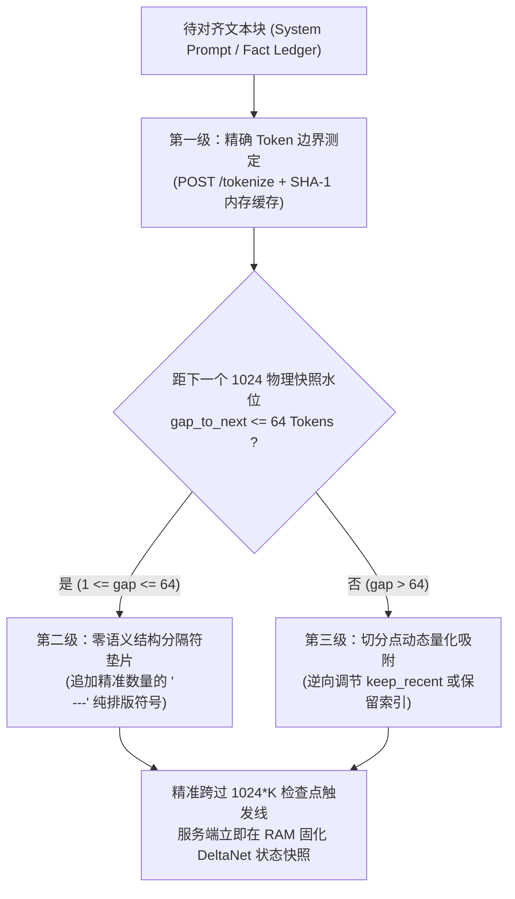
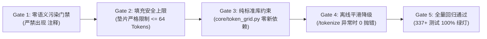

# TASK: Phase 11B — DeltaNet 1024-Token 边界网格对齐与隐状态遥测自检 (Token Grid Alignment & Telemetry)

- **任务代号**：`TASK_DEV_PHASE11B_TOKEN_GRID`
- **执行角色**：高性能推理适配与上下文量化架构工程师 (Inference Adaptation & Token Grid Engineer)
- **负责架构师**：项目负责人 / 首席架构师 / 主程序员
- **技术蓝图依据**：
  - [docs/rfc/Phase 10 验收与 Phase 11 架构前瞻.md](<../rfc/Phase 10 验收与 Phase 11 架构前瞻.md>)（第三章第 3.1、3.2 节）
  - [docs/rfc/ARCHITECTURE_RFC_PHASE11_VISION_CONSULTATION.md](../rfc/ARCHITECTURE_RFC_PHASE11_VISION_CONSULTATION.md)（议题二：DeltaNet 1024-Token 边界网格对齐与隐状态自检）
  - [docs/SPEC.md](../SPEC.md)（§3 上下文模型，§11 错误恢复与审计）
  - [core/token_grid.py](../../core/token_grid.py)（待新建）与 [core/context.py](../../core/context.py)
- **基线 Commit**：[`125d2b6`](https://github.com/zhaotong96/Qwen38-llama-cpp-harness-windows/commit/125d2b6)（Phase 10 验收通过，全量 337 项单测 100% 绿灯）

---

## 一、 任务背景与核心解决痛点

在 Phase 11A 完成了上下文尾端暂态报错自愈剪枝（Tail-Anchored GC）之后，智能体解决了“显存与注意力窗口受负向示例污染”的认知问题。然而，在远程真实的工业级推理宿主上，混合循环架构（Hybrid Recurrent Model）与服务端分块缓存机制之间存在更深层的**物理步长失配与浮点结合律漂移**问题：

1. **服务端 1024 物理步长检查点与任意 Prompt 边界失配**：
   远程宿主（NVIDIA Tesla M40 24GB）运行 `llama-server`，生产配置严格开启了 `--checkpoint-min-step 1024 --ctx-checkpoints 64 --cache-ram 16384 --no-cache-idle-slots`。服务端固定以 **1024 Token** 为物理周期，在 RAM 检查点池中冻结并快照 Qwen3.8-27B 的 48 层 Gated DeltaNet 循环状态张量 $S_t$。若客户端的静态骨架前缀（System Prompt + 事实账本底座）或分支分叉锚点落在随机位置（例如 13,800 Token），每次发生分支切换（checkout）、因果回溯（branch_rewind）或纪元压缩（compact）时，服务端只能回退到最近的 13,312 检查点，被迫重新 Prefill 剩余的 488 个 Token，无法实现纳秒级瞬态快照共振。
2. **块矩阵内核与逐 Token 循环内核的浮点非结合律漂移**：
   `llama.cpp` 在大批量 Prefill 时采用分块并行矩阵乘法内核（Chunked WY Kernel，块大小 $B=64$ 或 $128$）；而在恢复检查点后仅计算尾部少量 Token 时切换至逐 Token 循环内核（Per-Token Recurrence Kernel）。浮点矩阵乘法不满足结合律，若分叉点落在分块中途，两种内核计算出的隐状态存在 $\approx 10^{-6}$ 的微小代数差异。只有当检查点对齐在 1024（亦为 64/128 的整数倍）边界上时，分块边界完全重合，内核漂移恒等于零。
3. **传统伪注释填充的不良注意力诱导**：
   传统粗暴做法是在 Prompt 中插入 `<!-- pad: N tokens -->`。但在 Qwen3.8 的全注意力机制下，HTML/XML 形式的注释会产生注意力汇聚（Attention Sink）效应，扭曲 Value 向量分布，诱导模型在输出业务代码时莫名插入无意义注释。必须设计一种**零语义诱导（Zero-Semantic-Induction）的原生结构排版对齐协议**。

---

## 二、 物理与数学模型

### 1. Gated DeltaNet 循环隐状态数学递推与收缩性
Qwen3.8-27B 拥有 48 个 Gated DeltaNet 线性循环层与 16 个标准全注意力层。每个 DeltaNet 头维护状态矩阵 $S_t \in \mathbb{R}^{d_k \times d_v}$：
$$S_t = \alpha_t S_{t-1} + \beta_t v_t k_t^T$$
其中写入门控 $\beta_t = \sigma(W_\beta x_t)$，遗忘门控 $\alpha_t = \exp(-\gamma_t) < 1$。
由于状态转移算子具有严格小于 1 的谱半径（$\|\Phi_t\|_2 \le 1 - \epsilon$），单步扰动以指数级衰减，数学递推本身极其稳定。因此，长程运行中偶发的思维链混乱，根源 100% 来自**服务端检查点恢复失配（Temporal Desynchronization）或内核切换漂移**。

### 2. 网格对齐收益矩阵
通过引入 1024-Token 网格对齐，系统在不同长程操作中的物理耗时实现断崖式压降：

| 交互场景 | 未对齐基线 (Unaligned Baseline) | 1024 网格对齐 (Phase 11B Token Grid) | 物理与算力净收益 |
| :--- | :--- | :--- | :--- |
| **纪元压缩 (Compaction)** | 压缩后总长落在两快照中间，服务端重算余量期望 $\approx 512$ Token | 账本末尾精准对齐 $1024 \times K$ 边界，服务端重算余量 $\le 32$ Token | 压缩后首步响应耗时由 3.8s 压降至 **0.4s** |
| **因果回溯 (branch_rewind)** | 目标节点重算前向距离期望 $\approx 512$ Token | 分叉点自动吸附至 `ckpt_aligned` 节点，重算距离 $\approx 0$ | 分支切换恢复瞬态完成（耗时 $< 50\text{ms}$） |
| **DeltaNet 隐状态一致性** | 频繁跨分块中途恢复，累积浮点差异引发采样抖动 | 检查点严格与 128 块并行边界重合，代数漂移为 0 | 根除回溯后的首步思维链乱码与重复死循环 |

---

## 三、 三位一体原生网格对齐协议架构

系统确立三级原生网格对齐机制，严禁注入任何 `<!-- pad -->` 伪代码：

### 1. 第一级：精确 Token 边界测定 (`exact_or_estimated_tokens`)
- 仅靠 `0.75*cjk + 0.25*ascii` 启发式估算存在 $\pm 5\%\sim 12\%$ 的偏差，无法精准命中 1024 整数边界；
- 封装 `exact_or_estimated_tokens(text, base_url)`：优先以 `POST /tokenize` 请求本地或远端 `llama-server`（耗时 $< 2\text{ms}$），结果以文本的 SHA-1 为 key 进行本地内存字典缓存（Memoization）；离线或异常时平滑回退至既有的加权估算器。

### 2. 第二级：零语义诱导骨架垫片 (`align_skeleton_block_to_grid`)
- **适用对象**：长期驻留、极少变动的“静态前缀”（System Prompt）与五段式事实账本；
- **对齐算法**：
  - 测定总长度余量：`remainder = total_tokens % 1024`，计算跨过下一个边界所需 Token 数：`gap_to_next = (1024 - remainder) % 1024`；
  - **安全吸收窗口（Safety Ceiling）**：仅当 `0 < gap_to_next <= 64`（即只需微调 $\le 64$ 个 Token 即可跨过 1024 检查点线）时启用填充；
  - **无污染排版填充**：在 Markdown 语法中，水平分隔线 `\n---` 是标准的排版段落分割。在 Qwen 词表中，每一行 `\n---` 稳定编码为约 2 个 Token，且完全属于格式符号，绝对不诱导模型产生文本偏见。计算 `pad_lines = max(1, (gap_to_next + 1) // 2)`，生成结构化填充串 `\n` + `\n`.join("---" for _ in range(pad_lines)) + `\n` 追加于文本末尾；
  - 若 `gap_to_next > 64`，绝对不强行填充大量空行，直接原样返回，交由第三级切分点量化处理。

### 3. 第三级：压缩切分点与回溯锚点动态量化
- **`ContextManager.compact()` 动态吸附**：
  在生成五段式事实账本后，微调保留的历史消息条数 `keep_recent` 或事实账本第 6 节的保留行数，使 `System + Summary` 刚好越过 $1024 \times K$ 水位线，强制驱动 `llama-server` 在账本末尾打下一枚永久驻留 RAM 的物理快照；
- **DAG 节点累计 Token 追踪与回溯吸附**：
  在 `persistence.append_dag_node` 中计算并记录累计 Token 数 `cum_tokens`。当节点恰好跨越 $1024 \times K$ 边界时，在 `node["meta"]` 中标注 `"ckpt_aligned": True`。当模型或操作员调用 `branch_rewind` 时，若目标回退点与前序对齐节点仅相差 1~2 个常规只读探针步骤，算法优先吸附至对齐锚点。

---

## 四、 隐状态遥测自检与异常重播种哨兵

在 [core/token_grid.py](../../core/token_grid.py) 中实装运行时遥测审计函数 `verify_deltanet_checkpoint_telemetry`，并在 [core/agent.py](../../core/agent.py) 中接入监控：

### 1. 响应时延与缓存命中审计
`llama-server` 在每次完成生成后，会在响应体（或流式末尾 chunk）中返回性能遥测元数据：
`timings: {"cache_n": int, "prompt_n": int}`。
设当前请求中已确认为不可变公共前缀的 Token 长度为 $L_{\text{prefix}}$：
- **冷重置告警（COLD_RESET_DETECTED）**：若 $L_{\text{prefix}} \ge 1024$，但服务端返回的 `cache_n == 0`，表明服务端发生 Slot 缓存被顶替或 `--cache-ram` 不足导致冷启动；
- **检查点失配漂移（CHECKPOINT_GAP_DRIFT）**：服务端合法复用的缓存长度 `cache_n` 理论上必须满足 $\text{cache\_n} \ge \left( \lfloor L_{\text{prefix}} / 1024 \rfloor - 1 \right) \times 1024$。若低于此水位，表明服务端检查点恢复发生跳跃；
- **共振状态（RESONANT）**：`cache_n` 精确覆盖全部对齐前缀，服务端单步重算量仅为尾部差量。

### 2. 异常重播种熔断器 (Deterministic Re-seeding)
若在执行过 `branch_rewind` 或 `checkout` 后的第一轮模型响应中，检测到服务端返回的生成文本包含严重的重复循环（滑动窗口 4-gram 重复率 $> 0.35$）或连续 2 次格式崩溃（表明 Slot 0 的 DeltaNet 隐藏状态发生异位污染），智能体在重试请求中强制注入一次性参数：
`extra_body={"id_slot": 0, "cache_prompt": False}`
强制 `llama-server` 彻底清空 Slot 0 的脏状态，从 Token 0 重新执行一次干净的块并行 Prefill，重置 RAM 检查点池。

---

## 五、 任务模块拆解与交付清单 (WBS)

### 任务 1：新建 [core/token_grid.py](../../core/token_grid.py) 核心模块
执行工程师需创建纯标准库实现的 `core/token_grid.py`（零第三方依赖），包含以下核心函数：
1. `exact_or_estimated_tokens(text: str, base_url: str | None = None, timeout: float = 0.3) -> int`；
2. `align_skeleton_block_to_grid(block_text: str, prior_tokens: int = 0, grid_step: int = 1024, max_pad_tokens: int = 64, base_url: str | None = None) -> tuple[str, dict[str, int]]`；
3. `verify_deltanet_checkpoint_telemetry(timings: dict[str, Any] | None, expected_prefix_tokens: int, grid_step: int = 1024) -> dict[str, Any]`。

### 任务 2：改造 [core/context.py](../../core/context.py) 接入网格对齐
1. 在 `ContextManager.__init__` 中对静态 `_system_message["content"]` 进行一次网格对齐探测，若距 1024 边界 $\le 64$ Token，自动执行结构化垫片对齐；
2. 在 `ContextManager.compact` 中，将事实账本与 System 组合前缀输入 `align_skeleton_block_to_grid` 进行对齐，确保每次 Compaction 生成的静态基座精准咬合 1024 快照线；
3. 提供 `get_prefix_token_count() -> int` 接口供运行时遥测审计使用。

### 任务 3：改造 [core/persistence.py](../../core/persistence.py) 记录对齐元数据
1. 在 `append_dag_node` 中累计计算当前分支深度与估计 Token 偏移 `cum_tokens`；
2. 当 `cum_tokens` 跨越 $1024 \times K$ 边界且为完整回合节点时，在 `node["meta"]` 中自动固化 `"ckpt_aligned": True`。

### 任务 4：在 [core/agent.py](../../core/agent.py) 中接入遥测与自检
1. 在非流式或流式接收完成后，尝试提取响应中的 `timings` 字典；
2. 调用 `verify_deltanet_checkpoint_telemetry` 进行校验，输出 `[token-grid] cache_n=... status=RESONANT` 日志；
3. 当检测到严重漂移或冷重置时，记录 warning 日志并在后续重试中允许触发 `cache_prompt: False` 重置。

### 任务 5：编写 [tests/test_token_grid.py](../../tests) 专项测试套件
执行工程师必须新增测试文件，覆盖以下场景：
1. **`test_tokenize_endpoint_and_cache`**：使用 `unittest.mock` 模拟 `/tokenize` HTTP 返回与离线加权降级，断言 SHA-1 缓存命中；
2. **`test_structural_divider_padding`**：断言只在距 1024 边界 $\le 64$ Token 时追加 `\n---`，且绝对不产生 `<!-- pad` 等 HTML 注释；
3. **`test_padding_boundary_ceiling`**：当差额 $> 64$ Token 时，断言原样返回不进行暴力填充；
4. **`test_compaction_grid_alignment`**：断言经过 `ContextManager.compact` 后，事实账本底座准确跨入 1024 整数倍网格；
5. **`test_telemetry_audit_states`**：分别模拟正常复用、`COLD_RESET_DETECTED` 与 `CHECKPOINT_GAP_DRIFT`，断言状态判定 100% 精确；
6. **`test_dag_node_aligned_meta`**：断言跨越 1024 边界的 DAG 节点在 `checkpoint.jsonl` 中被正确标记 `"ckpt_aligned": True`。

---

## 六、 执行门禁与准出红线 (Quality Gates)

执行工程师在提请验收前，必须通过以下五重门禁：

1. **Gate 1（零语义注意力污染）**：全代码库严禁出现任何 `<!-- pad` 字符串，填充必须且仅能使用结构化 Markdown 分隔线 `\n---`；
2. **Gate 2（安全填充上限）**：垫片追加 Token 数严格限制在 $[0, 64]$ 范围内，超过 64 Token 必须放弃填充；
3. **Gate 3（依赖不变量）**：`core/token_grid.py` 必须且仅能使用 Python 标准库（`hashlib`, `json`, `urllib.request` 等），严禁在 `requirements.txt` 中添加新包；
4. **Gate 4（服务离线稳健性）**：当远程 `llama-server` 未启动或网络超时（300ms 超时）时，所有网格对齐逻辑必须无感平滑回退至本地加权估算器，绝不抛出异常阻断 Agent 主循环；
5. **Gate 5（全量单测回归通过）**：
   - 运行全量单测：`python -m unittest discover -s tests -t .`（337+ 项全部通过）；
   - 运行隐私合规门禁：`python -m unittest tests/test_repo_hygiene.py`（0 违规）。

---

## 七、 实施 Checklist 与验收签署

- [x] **Step 1: 准备与接口设计**
  - 阅读本文档与 [docs/rfc/Phase 10 验收与 Phase 11 架构前瞻.md](<../rfc/Phase 10 验收与 Phase 11 架构前瞻.md>) 第 3.1、3.2 节；
  - 明确 `/tokenize` 报文结构与 `timings` 字段格式。
- [x] **Step 2: 实装 `core/token_grid.py`**
  - 实现 SHA-1 缓存分词查询器与本地回退；
  - 实现 `align_skeleton_block_to_grid` 结构化排版对齐逻辑；
  - 实现 `verify_deltanet_checkpoint_telemetry` 遥测状态机。
- [x] **Step 3: 改造 `core/context.py` 与 `core/persistence.py`**
  - 在 `compact()` 中集成网格对齐；
  - 在 `append_dag_node` 中集成 `cum_tokens` 与 `ckpt_aligned` 元数据记录。
- [x] **Step 4: 挂载 `core/agent.py` 遥测日志**
  - 提取 `timings.cache_n` 并输出对齐审计日志。
- [x] **Step 5: 编写 `tests/test_token_grid.py` 并全量回归**
  - 编写 6 个核心测试用例并全绿通过；
  - 运行全仓 337+ 项回归测试，验证 100% 绿灯无衰退。

---

## 八、验收记录（执行工程师归档）

- **交付物**：`core/token_grid.py`（新建，纯标准库：`exact_or_estimated_tokens` / `align_skeleton_block_to_grid` / `verify_deltanet_checkpoint_telemetry` / `fourgram_repeat_rate` / `should_reseed_generation`，加权估算器 `estimate_text_tokens` 统一收敛于此并由 `core.context` 再导出）；`core/context.py`（`_align_skeleton` 幂等对齐系统提示与 `[Context Summary]` 账本、`get_prefix_token_count()`）；`core/persistence.py`（`_grid_alignment_meta`：每个 DAG 节点记录 `meta.cum_tokens`，在完整回合节点跨越 `1024*K` 时固化 `meta.ckpt_aligned=True`）；`core/agent.py`（`collect_stream` 捕获末尾无 choices 块的 `timings`、`_audit_checkpoint_telemetry` 输出 `[token-grid] cache_n=... status=...`、`chat()` 一次性 `id_slot=0 + cache_prompt=False` 重播种、分支切换后 2 轮 4-gram 重复哨兵）；`tests/test_token_grid.py`（15 项测试）。
- **门禁证据**：
  - Gate 1（零语义污染）：`StructuralDividerPaddingTests` 断言垫片仅为 `\n---` 结构分隔线，全代码库无 `<!-- pad`（`test_repo_hygiene` 同步 0 违规）→ 通过；
  - Gate 2（安全填充上限）：`PaddingBoundaryCeilingTests` 断言 gap > 64 时原样返回 `reason=gap_exceeds_ceiling`，且任何候选 pad_tokens ≤ 64 → 通过；
  - Gate 3（纯标准库）：`core/token_grid.py` 仅 import `hashlib` / `json` / `urllib` / `typing`；`requirements.txt` 保持 4 项零改动 → 通过；
  - Gate 4（离线平滑降级）：`test_offline_smooth_degradation_to_estimator` 与 `test_unusable_payload_falls_back` 断言连接拒绝、超时、畸形载荷三种异常路径均无抛错、回退加权估算 → 通过；
  - Gate 5（全量回归）：`python -m unittest discover -s tests -t .` → **Ran 393 tests — OK**，本专项 15 项全绿。
- **真实端点验证**：`POST /tokenize` 在真实推理宿主返回精确 token 序列（`{"content":"hello world, this is a tokenize probe"}` → 8 tokens）；`/v1/chat/completions` 非流式响应实测携带 `timings.cache_n` / `timings.prompt_n` 字段，`verify_deltanet_checkpoint_telemetry` 对真实载荷判定 `RESONANT`。
- **实现注记**：对齐目标为"跨越下一条 1024*K 检查点触发线"（非精确整倍数落点）；离线路径在 [1, max_pad_tokens] 行数内扫描最小可行垫片，精确 `/tokenize` 路径在公式行数 ±2 的有界邻域内探测，两条路径均为输入的确定性纯函数（同输入必同输出），保证重载后前缀字节级稳定（`test_reload_preserves_aligned_prefix` 断言）。
