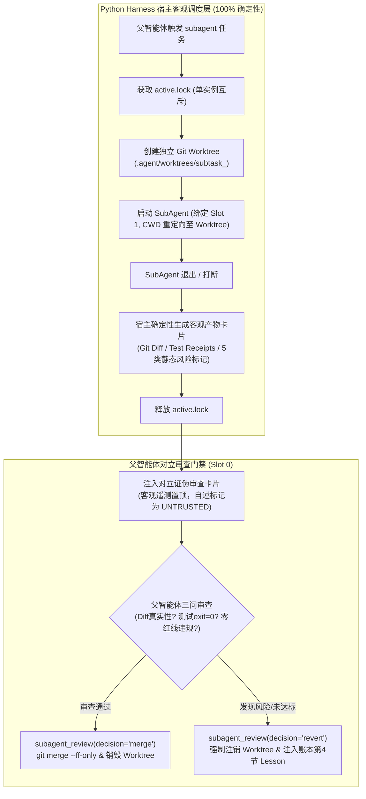
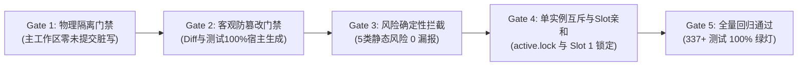

# TASK: Phase 11C — 分层子智能体 Git Worktree 物理隔离与对立证伪审查门禁 (SubAgent Worktree Gate)

- **任务代号**：`TASK_DEV_PHASE11C_SUBAGENT_WORKTREE`
- **执行角色**：分布式代理沙箱与安全准入架构工程师 (Agent Sandbox & Safety Gate Engineer)
- **负责架构师**：项目负责人 / 首席架构师 / 主程序员
- **技术蓝图依据**：
  - [docs/rfc/Phase 10 验收与 Phase 11 架构前瞻.md](<../rfc/Phase 10 验收与 Phase 11 架构前瞻.md>)（第四章第 4.1、4.2 节）
  - [docs/rfc/ARCHITECTURE_RFC_PHASE11_VISION_CONSULTATION.md](../rfc/ARCHITECTURE_RFC_PHASE11_VISION_CONSULTATION.md)（议题三：分层子智能体结构化产物契约与隔离审查门禁）
  - [docs/SPEC.md](../SPEC.md)（§4 Skill 契约规范，§7 工具分发协议与 §11 错误恢复）
  - [core/subagent_runner.py](../../core/subagent_runner.py) 与 [skills/subagent.py](../../skills/subagent.py)
- **基线 Commit**：[`125d2b6`](https://github.com/zhaotong96/Qwen38-llama-cpp-harness-windows/commit/125d2b6)（Phase 10 验收通过，全量 337 项单元测试 100% 绿灯）

---

## 一、 任务背景与核心解决痛点

在长程桌面与软件开发任务中，主智能体常通过 `subagent` 技能派生子智能体执行耗费大量探索步数的局部子任务（如源码检索、外部模块适配、独立单元测试等）。然而，当前 [core/subagent_runner.py](../../core/subagent_runner.py) 实现存在两大严重的系统工程安全漏洞：

1. **主工作区脏写污染（Silent Workspace Contamination）**：
   目前子智能体进程与主智能体共享同一个主工作区根目录 `ROOT`。若子智能体在执行代码修改期间发生异常中止、被操作员强制打断（`POST /interrupt`）、或写入了未跑通测试的半截残缺代码，主工作区的 `main` 分支在物理上已被污染。主智能体不仅无法无损回滚，甚至会在后续执行中因脏文件引发连环报错。
2. **父模型顺从偏见与谎报漏洞（Sycophantic Over-Trust & Hallucinated Claims）**：
   子智能体退出后，仅向父智能体返回一段不超过 2000 字符的自然语言文本报告（`report`）。大模型在面对一段看似流畅的“任务已顺利完成，测试全部通过”自述文本时，天然处于**正向确认顺从模式（Confirmation Bias）**，极易盲目信任子智能体口头承诺；而一旦子智能体修改了关键系统红线文件、删除了报错的测试断言、甚至实际未落盘任何文件修改，父智能体根本无从察觉。
3. **单实例互斥与硬件槽位绑定的继承要求**：
   必须严格恪守全系统核心不变性：**全系统同一时刻至多运行一个活跃 SubAgent**（`.agent/subagents/active.lock`），且主智能体绑定于 `id_slot: 0`、子智能体绑定于 `id_slot: 1`，绝不可因引入隔离而发生锁争用或显存超配。

---

## 二、 架构契约与核心机制设计



### 1. Git Worktree 物理沙箱隔离
- 当派生子智能体时，宿主自动执行：
  `git worktree add -B subtask_<sub_id> .agent/worktrees/<sub_id> HEAD`
- 独立物理目录 `.agent/worktrees/<sub_id>` 与主仓库共享底层的 `.git/objects` 对象库，创建耗时 $< 40\text{ms}$，额外磁盘开销近乎为 0；
- 子智能体进程的 `cwd` 及文件工具读写根路径严格重定向至该 Worktree 目录；
- **物理隔离不变量**：即便子智能体在执行期间发生不可逆破坏、语法崩溃或被强行 Kill，**主工作区 `ROOT` 在物理上纤毫不染**。

### 2. 宿主防篡改产物卡片 (`artifact_card.json`)
为杜绝子智能体“谎报军情”，卡片中的客观事实字段 **100% 由 Python 宿主通过 Git 与拦截器确定性计算生成**，子智能体 LLM 仅负责填写主观解释：

```json
{
  "subagent_id": "sub_20261031_120000_123456",
  "branch": "subtask_sub_20261031_120000_123456",
  "worktree_path": ".agent/worktrees/sub_20261031_120000_123456",
  "hazard_flags": [],
  "files_modified": [
    {"path": "skills/calculator.py", "status": "M", "sha256": "e3b0c442..."}
  ],
  "tests_executed": [
    {"step": 4, "command": "python -m unittest tests/test_calc.py", "exit_code": 0}
  ],
  "git_diff_patch": "diff --git a/skills/calculator.py...",
  "subagent_summary": "Implemented calculator multiplication",
  "risk_assessment": "Low risk, unit tests added"
}
```

### 3. 五类确定性静态风险标记 (Hazard Flags)
在将卡片呈递给父智能体前，宿主自动通过正则与规则引擎预检以下 5 类硬性风险：

| 静态风险标记代码 (Hazard Flag) | 宿主确定性触发判据 | 防御的典型子智能体作弊/破坏行为 |
| :--- | :--- | :--- |
| **`HAZARD_TEST_ASSERTION_REMOVED`** | Git Diff 在 `tests/` 目录下存在以 `-` 开头的 `def test_` 或 `self.assert` / `assert` 删除行。 | 为让报错测试“变绿”而私自删减既有单元测试断言。 |
| **`HAZARD_TEST_SKIP_INJECTED`** | Git Diff 中新增了 `@unittest.skip`、`pytest.mark.skip` 或空 `pass` 测试桩。 | 通过跳过测试伪造绿灯绕过 TDD 门禁。 |
| **`HAZARD_UNVERIFIED_CODE_EDIT`** | `files_modified` 含 `.py` 源码，但在最后一次修改源码步骤之后，无任何 `exit=0` 的测试执行记录。 | 修改了 Python 业务代码却未跑测试验证即匆忙交差。 |
| **`HAZARD_REDLINE_FILE_MODIFIED`** | 修改了 `requirements.txt`、`docs/SPEC.md`、`package.json` 或 `FROZEN_CORE_SKILLS`。 | 违反零新增依赖、零构建或核心技能冻结保护红线。 |
| **`HAZARD_EMPTY_OR_NOOP_DIFF`** | 子智能体声称完成且状态为 completed，但 `files_modified` 为空列表。 | 仅输出口头修复说明而未实际落盘任何代码文件。 |

### 4. 父智能体对立证伪审查机制 (Adversarial Falsification)
向父智能体（Slot 0）注入审查提示词时，强制遵循“**客观遥测置顶 + 静态风险强警示 + 自述标记为 UNTRUSTED**”的顺序，引导模型在 `<think>` 中开展三问对立审查：
1. **(Q1) 真实性**：Git Diff 是否真实达成了任务目标，有无硬编码桩函数或附带删改？
2. **(Q2) 验证性**：最后一次文件写入后，是否有真实的测试命令返回 `exit=0`？
3. **(Q3) 合规性**：是否存在架构红线违规或未申报的脏文件？

### 5. 双阶段合入与一键回滚裁决 (`skills/subagent_review.py`)
父智能体评估后，通过调用专属技能 `subagent_review(subagent_id, decision, reason)` 实施裁决：
- **`decision="merge"`**：在工作目录提交变更后，宿主在主工作区执行原子快进合并：  
  `git merge --ff-only subtask_<sub_id>`，随后干净删除临时 Worktree 与临时分支；
- **`decision="revert"`**：宿主直接物理销毁 Worktree 并强制删除分支（`git branch -D`），主工作区保持 100% 纯净；同时**自动向五段式事实账本第 4 节追加因果教训**：  
  `[Branch Rewind Lesson] (SubAgent '<id>' reverted): <reason>`。

---

## 三、 任务模块拆解与具体实现指引 (WBS)

### 任务 1：新建 [core/subagent_gate.py](../../core/subagent_gate.py) 门禁模块
执行工程师需新建 `core/subagent_gate.py`，实现以下核心逻辑：
1. **`detect_diff_hazards(files_modified, diff_text, tests_executed, last_write_step) -> list[str]`**：
   - 使用正则表达式逐行扫描 unified diff，捕获上述 5 类静态风险标记；
2. **`create_subagent_worktree(subagent_id: str, repo_root: Path = ROOT) -> Path`**：
   - 执行 `git worktree add -B subtask_<sub_id> .agent/worktrees/<sub_id> HEAD`，返回物理路径；
3. **`generate_artifact_card(subagent_id: str, wt_path: Path, tests_executed: list, summary: str) -> dict`**：
   - 通过 `git status --porcelain` 与 `git diff HEAD` 提取客观修改清单与统一 Diff；
   - 计算修改文件的 SHA-256 哈希值；
   - 调用 `detect_diff_hazards` 标定风险，落盘至 `.agent/subagents/<id>/artifact_card.json`；
4. **`format_adversarial_review_prompt(card: dict) -> str`**：
   - 格式化对立证伪卡片，将 `hazard_flags` 与 `git_diff_patch` 置顶；
5. **`finalize_subagent_worktree(subagent_id: str, decision: str, reason: str, repo_root: Path = ROOT) -> dict`**：
   - 实施 `--ff-only` 合并或一键回滚销毁，清理 Worktree。

### 任务 2：升级 [core/subagent_runner.py](../../core/subagent_runner.py)
1. 在 `run_subagent` 中集成 Worktree 生命周期：
   - 启动前调用 `create_subagent_worktree`；
   - 子智能体的 `Agent(tasks_root_override=..., work_dir=wt_path)` 工作目录重定向至 Worktree；
2. 捕获子智能体执行期间的 `tests_executed`（通过工具调度器拦截 `shell` 命令，记录命令与退出码）；
3. 退出时调用 `generate_artifact_card` 生成卡片；
4. 返回给父智能体的结果中内联格式化的对立审查卡片文本。

### 任务 3：新建 [skills/subagent_review.py](../../skills/subagent_review.py) 技能
按照 SPEC §4 规范创建父智能体审查决策技能：
```python
DESCRIPTION = (
    "Review an isolated SubAgent worktree artifact delivery card and execute "
    "either a fast-forward merge into the main workspace or a complete revert/cleanup."
)
PARAMETERS = {
    "type": "object",
    "properties": {
        "subagent_id": {
            "type": "string",
            "description": "Unique identifier of the completed SubAgent.",
        },
        "decision": {
            "type": "string",
            "enum": ["merge", "revert"],
            "description": "Review decision: 'merge' (fast-forward) or 'revert' (discard).",
        },
        "reason": {
            "type": "string",
            "description": "Architectural reasoning and verification evidence justifying the decision.",
        },
    },
    "required": ["subagent_id", "decision", "reason"],
}
```

### 任务 4：编写 [tests/test_subagent_gate.py](../../tests) 专项测试套件
执行工程师必须新增测试文件，覆盖以下 7 大核心场景：
1. **`test_worktree_creation_and_physical_isolation`**：验证 Worktree 正确创建，在 Worktree 内写文件绝对不影响主工作区；
2. **`test_hazard_test_assertion_removed`**：模拟 Diff 中删除 `self.assertEqual`，断言 100% 触发 `HAZARD_TEST_ASSERTION_REMOVED`；
3. **`test_hazard_test_skip_injected`**：模拟 Diff 中增加 `@unittest.skip`，断言 100% 触发 `HAZARD_TEST_SKIP_INJECTED`；
4. **`test_hazard_unverified_code_edit`**：模拟修改 `.py` 源码但无后续 `exit=0` 测试，断言触发 `HAZARD_UNVERIFIED_CODE_EDIT`；
5. **`test_hazard_redline_file_modified`**：模拟触碰 `requirements.txt`，断言 100% 拦截并报警；
6. **`test_decision_merge_fast_forward`**：测试合法代码修改在 `decision="merge"` 下通过 `--ff-only` 合入主分支，Worktree 干净移除；
7. **`test_decision_revert_and_ledger_injection`**：测试 `decision="revert"` 下主工作区无脏文件残留，且成功向五段式事实账本注入 `[Branch Rewind Lesson]`。

---

## 四、 执行门禁与准出红线 (Quality Gates)

执行工程师提请代码合并前，必须核验通过以下五项硬性门禁：



1. **Gate 1（主工作区物理零污染）**：子智能体运行中或异常终止时，主仓库 `git status --porcelain` 必须保持无非预期修改；
2. **Gate 2（客观遥测防篡改）**：卡片中的 `files_modified`、`git_diff_patch` 与 `tests_executed` 必须由 Python 宿主确定性抓取，绝不允许子智能体 LLM 覆写；
3. **Gate 3（静态风险零漏报）**：测试断言删除、测试挂起、修改未测、红线文件修改 4 类破坏行为必须 100% 触发对应 `HAZARD_*` 标记；
4. **Gate 4（单实例串行互斥）**：严格保持 `.agent/subagents/active.lock` 机制，任何时刻全系统禁止并发运行两个 SubAgent；
5. **Gate 5（全量回归与零依赖）**：
   - 运行全量单测：`python -m unittest discover -s tests -t .`（337+ 项全部通过）；
   - 运行隐私合规门禁：`python -m unittest tests/test_repo_hygiene.py`（0 违规）；
   - `requirements.txt` 保持锁定 4 项不变。

---

## 五、 实施 Checklist 与验收签署

- [x] **Step 1: 规范与环境核验**
  - 阅读本文档与 [docs/rfc/Phase 10 验收与 Phase 11 架构前瞻.md](<../rfc/Phase 10 验收与 Phase 11 架构前瞻.md>) 第 4.1、4.2 节；
  - 确认本地 Git 支持 `git worktree` 原语（Git 2.5+，当前环境 PortableGit 2.53 完全支持）。
- [x] **Step 2: 实装 `core/subagent_gate.py`**
  - 实现 5 类静态风险标记检测正则；
  - 实现 Worktree 创建、卡片落盘与 `--ff-only` 合并/回滚管道。
- [x] **Step 3: 改造 `core/subagent_runner.py`**
  - 将子智能体执行根路径指向 Worktree 物理沙箱；
  - 拦截测试回执并输出对立证伪交付卡片。
- [x] **Step 4: 实装 `skills/subagent_review.py`**
  - 实现 SPEC §4 规范下的审查技能，并将其纳入 `core/skill_sandbox.py` 的豁免与冻结集。
- [x] **Step 5: 编写 `tests/test_subagent_gate.py` 并全量回归**
  - 编写 7 大场景测试用例并全绿通过；
  - 运行全仓 337+ 项回归测试，断言 100% 绿灯无回退。

---

## 六、验收记录（执行工程师归档）

- **交付物**：`core/subagent_gate.py`（新建：`create_subagent_worktree` / `detect_diff_hazards` / `generate_artifact_card` / `format_adversarial_review_prompt` / `finalize_subagent_worktree`）；`core/subagent_runner.py`（Worktree 生命周期 + `tools.ROOT` 重定向 + 写工具/shell 遥测拦截 + 卡片生成 + `EXCLUDED_META_SKILLS` 扩容 `subagent_review` / `crystallize_macro` + `SUBAGENT_WORKTREE` 环境开关）；`skills/subagent_review.py`（新建审查裁决技能）；`core/skill_sandbox.py`（`FROZEN_CORE_SKILLS` 纳入 `subagent_review`、`crystallize_macro`）；`tests/test_subagent_gate.py`（17 项测试）。
- **门禁证据**：
  - Gate 1（主工作区物理零污染）：`WorktreeCreationAndIsolationTests` 断言 Worktree 内写入后主仓 `git status --porcelain` 为空；`RunnerIntegrationTests` 断言子智能体落盘文件只存在于 Worktree 中 → 通过；
  - Gate 2（客观遥测防篡改）：`ArtifactCardTests.test_artifact_card_is_host_authoritative` 断言 `files_modified` / SHA-256 / diff 全部由宿主从 Git 计算并落盘 `artifact_card.json`，LLM 仅填自述字段 → 通过；
  - Gate 3（静态风险零漏报）：`HazardDetectionTests` 五类标记（含"测试先于写入的旧 exit=0 不豁免"负例与"新建非冻结技能不误报"负例）100% 命中 → 通过；
  - Gate 4（单实例互斥与 Slot 亲和）：`tests/test_subagent.py` 全量保留 `active.lock` 互斥与 id_slot 路由测试（8 项全绿），新增 `subagent_review` / `crystallize_macro` 进入子智能体元技能排除集 → 通过；
  - Gate 5（全量回归与零依赖）：`python -m unittest discover -s tests -t .` → **Ran 393 tests — OK**，本专项 17 项全绿；`requirements.txt` 保持 4 项不变。
- **机制注记**：`revert` 裁决回执首行携带 `[Branch Rewind Lesson] (SubAgent '<id>' reverted): <reason>`，由既有红线保真管道（`Agent._extract_pinned_redlines` → 账本第 4 节逐字保留）自动固化，`DecisionRevertTests` 端到端验证；merge 路径按 `commit → merge --ff-only → 清理 worktree/branch` 原子执行。RFC 4.1 中的 `role_mode` 流水线编排（Scout/Builder/Verifier 接力）为可选演进项，未纳入本卡片 WBS，已在研发汇报中登记为后续提案。
