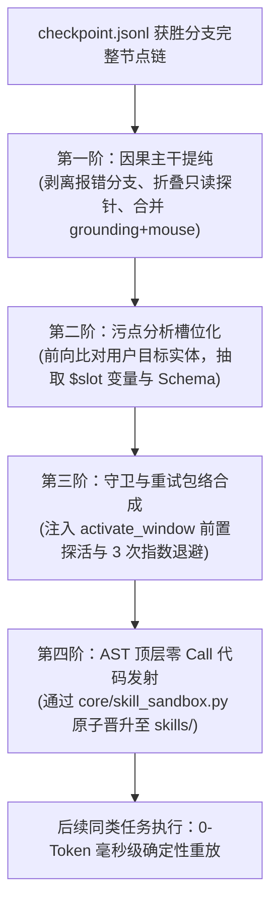
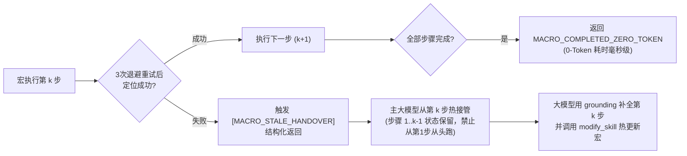
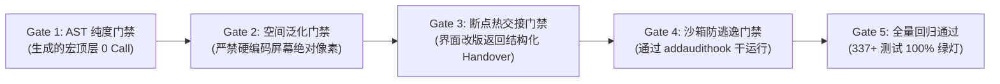

# TASK: Phase 11D — 复杂桌面工作流宏结晶与自举自愈编译 (Macro Crystallization & Hot Handover)

- **任务代号**：`TASK_DEV_PHASE11D_MACRO_CRYSTALLIZATION`
- **执行角色**：程序合成与确定性工作流编译器架构工程师 (Program Synthesis & RPA Compiler Engineer)
- **负责架构师**：项目负责人 / 首席架构师 / 主程序员
- **技术蓝图依据**：
  - [docs/rfc/Phase 10 验收与 Phase 11 架构前瞻.md](<../rfc/Phase 10 验收与 Phase 11 架构前瞻.md>)（第五章第 5.1、5.2 节）
  - [docs/rfc/ARCHITECTURE_RFC_PHASE11_VISION_CONSULTATION.md](../rfc/ARCHITECTURE_RFC_PHASE11_VISION_CONSULTATION.md)（议题四：复杂桌面工作流宏结晶与自举编译）
  - [docs/SPEC.md](../SPEC.md)（§4 Skill 契约规范与 §13 原生交互基石）
  - [core/skill_sandbox.py](../../core/skill_sandbox.py)（AST 顶层零 Call 纯度定理与 SPEC §4 准入沙箱）
- **基线 Commit**：[`125d2b6`](https://github.com/zhaotong96/Qwen38-llama-cpp-harness-windows/commit/125d2b6)（Phase 10 验收通过，全量 337 项单元测试 100% 绿灯）

---

## 一、 任务背景与核心解决痛点

在 Phase 10 全面交付了高内聚的桌面交互四大原语（`window_manager`、`grounding`、`clipboard`、`mouse`）后，智能体已经能够在 Windows 环境下自主打通长达 30 至 60 步的复杂桌面自动化流程（例如：激活业务软件/浏览器 $\rightarrow$ Chromium DOM 动态唤醒 $\rightarrow$ 语义定位检索 $\rightarrow$ 剪贴板原子注入 $\rightarrow$ 触发报表导出 $\rightarrow$ 调用本地 Python 脚本清洗）。然而，在当前架构下，该长程探索成果面临严重的**重复计算浪费与随机采样抖动**：

1. **同类任务重复推理与 Token 严重消耗**：
   每当用户下发相似的周期性或参数化任务时，大模型必须重新经历 30~60 轮的逐 Token ReAct 推理，单次执行耗费数万 Token 与数分钟等待，并持续占用 Tesla M40 宝贵的推理槽位；
2. **单步采样抖动与累积误差**：
   长程逐步推理使得整条链路脆弱地暴露在大模型的随机性抖动之下，任一步骤若产生细微的误点击或拼写偏离，都会导致自动化流程中断；
3. **传统宏录制脚本的脆弱死锁陷阱**：
   传统的按键/鼠标录制器严重依赖绝对屏幕像素坐标 $(x, y)$，窗口一旦发生位移、缩放或分辨率调整立即全面崩溃；且当目标界面发生小版本升级时，传统脚本直接报错抛异常，导致已经产生了一半屏幕状态的软件陷入不可自愈的僵死状态。

---

## 二、 核心形式化模型与四阶编译管道

基于**前向数据流污点追踪（Forward Dataflow Taint Tracking）与版本空间代数（Version Space Algebra）**，本任务实现一个能将真实成功 DAG 分支轨迹反向抽象为确定性 Python 技能的代码发射编译器 [core/macro_compiler.py](../../core/macro_compiler.py)：



### 1. 第一阶：因果主干提纯与空间泛化 (Causal Spine Deforestation)
- 扫描获胜分支从根节点到 `task_done` 的全部工具调用，剔除所有失败重试节点与纯观测只读探针（独立的 `screenshot`、`pic_zoom`、`ui_tree`）；
- 将连续的 `grounding(target=T, role=R, auto_id=A)` 命中与其紧随其后的 `mouse(action="click", ...)` 自动折叠为一条高阶原子动作 `("uia_click", {"target": T, "role": R, "auto_id": A})`；
- **空间泛化不变性（Spatial Invariance）**：**绝对严禁硬编码绝对屏幕像素坐标 $(x, y)$ 作为主定位符**！主定位符必须绑定 `grounding.py` 的三段式语义选择器（`auto_id` $\rightarrow$ `exact_name` + `role`）；若目标为纯自绘控件，记录相对于目标窗口 DWM 边框的相对比例归一化坐标 $(rx, ry)$，确保目标窗口任意拖拽平移后 100% 稳定命中。

### 2. 第二阶：基于目标污点分析的参数槽位自动抽象 (Taint-Driven Parameterization)
- 提取用户初始任务描述 $G_0$ 的实体种子集 $T_{\text{seeds}}$：
  - 引号字面量 `["'“”‘’]([^"'“”‘’]{2,64})`；
  - ISO 日期格式 `\b\d{4}-\d{2}-\d{2}\b`；
  - 本地文件路径/文件名 `(?:[A-Za-z]:[\\/]|[\w\-]+\.(?:csv|xlsx|json|txt|py|sql|pdf))\b`；
  - 核心数值常量；
- 遍历动作序列：若某工具实参（如 `clipboard.set_text(text="2026-10-27")`）与污点种子完全匹配，则自动将其泛化为参数槽位 `$slot:target_date_1`，并在 `PARAMETERS["properties"]` 中注册该字段及默认值；凡未在 $G_0$ 中出现、仅作为 UI 控件标识的字符（如 "确定"、"导出"），一律判定为结构常量并固化在 `MACRO_STEPS` 中。

### 3. 第三阶：守卫与退避重试合成 (Guard & Retry Envelope Synthesis)
- 将每一个结晶动作包裹在 `_run_step_with_retry` 执行包络中：
  - 点击或粘贴前，必须调用 `window_manager.activate_window` 执行 150ms `WM_NULL` 探活，确保窗口置顶；
  - 遇到界面渲染延迟时，自动按 0.25s、0.50s、1.0s 指数退避重试 3 次，并触发 Chromium `WM_GETOBJECT` 自动重唤醒。

### 4. 第四阶：AST 顶层零 Call 纯度发射与沙箱晋升
- 发射标准 Python 源码 `skills/macro_<name>.py`，顶层仅包含常量字面量（`DESCRIPTION`、`PARAMETERS`、`DEFAULT_ARGS`、`MACRO_STEPS`）与纯函数定义，严格满足 AST 顶层零 Call 纯度定理；
- 自动调用 [core/skill_sandbox.py](../../core/skill_sandbox.py) 的 `verify_and_deploy_skill`，在 1.5 秒内完成沙箱 AST 检查与 `sys.addaudithook` 干运行验证，原子写入 `skills/` 目录并热重载注册表。

---

## 三、 宏陈旧失效探测与断点索引热交接协议 (Hot Handover)

为解决“软件界面微改版导致自动化中断后如何自愈”的核心难题，结晶宏实装三道自愈防线：



### 1. 断点索引热交接协议（`[MACRO_STALE_HANDOVER]`）
当宏在第 $k$ 步因界面改版（如按钮文字由“导出报表”改为“数据中心-导出”）而重试失败时，宏立即中止后续操作，向主 ReAct 循环返回标准化交接回执：
```json
{
  "ok": false,
  "status": "MACRO_STALE_AT_STEP",
  "macro_name": "macro_export_financial_report",
  "completed_steps_count": 2,
  "failed_step_index": 3,
  "failed_step_spec": {"op": "uia_click", "target": "导出报表", "role": "Button"},
  "recovery_directive": "[MACRO_STALE_HANDOVER] Steps 1..2 succeeded on screen. Do NOT restart from Step 1. Resume interactively from Step 3 (intent: 导出报表), then update this macro via modify_skill."
}
```

### 2. 交互式增量修复与自举沉淀
- 主大模型解析到 `[MACRO_STALE_HANDOVER]` 后，依据指令**严禁从第 1 步从头重新执行**，而是直接调用 `grounding` 探查当前屏幕，识别改版后的新控件并完成点击；
- 任务完成后，引导大模型通过既有的 `modify_skill` 更新该宏的 `MACRO_STEPS[2]` 选择器，清零失败计数，实现工作流的**自主进化自愈**；
- 若某宏连续 3 次无人修复且执行失败，由既有的 `record_skill_outcome` 自动隔离至 `.agent/skills_disabled/`。

---

## 四、 任务模块拆解与具体实现指引 (WBS)

### 任务 1：新建 [core/macro_compiler.py](../../core/macro_compiler.py) 编译器模块
执行工程师需新建 `core/macro_compiler.py`，实现以下核心类与函数：
1. **`extract_goal_taint_seeds(user_goal: str) -> dict[str, dict[str, str]]`**：
   - 提取日期、文件路径、引号文本等实体种子，构建槽位映射表；
2. **`extract_winning_spine(task_id: str, branch: str = "main") -> list[dict[str, Any]]`**：
   - 从指定任务的 `checkpoint.jsonl` 中过滤出主干动作，折叠只读探针；
3. **`synthesize_macro_skill_code(macro_name: str, description: str, parameters_schema: dict, default_values: dict, compiled_steps: list) -> str`**：
   - 生成 100% 纯度的 Python 模块源码，内嵌 `_bind_param`、`_run_step_with_retry` 与包含 `MACRO_STALE_HANDOVER` 回执的 `run` 函数；
4. **`compile_and_deploy_macro(task_id: str, macro_name: str, description: str, branch: str = "main", overwrite: bool = False) -> str`**：
   - 端到端完成轨迹提纯、代码合成并通过 `skill_sandbox.verify_and_deploy_skill` 原子晋升至 `skills/`。

### 任务 2：新建 [skills/crystallize_macro.py](../../skills/crystallize_macro.py) 触发技能
按照 SPEC §4 规范创建大模型可调用的宏结晶技能：
```python
DESCRIPTION = (
    "Compile and crystallize a successful multi-step desktop workflow from the current "
    "or specified task DAG trajectory into an AST-pure, zero-token deterministic Python skill."
)
PARAMETERS = {
    "type": "object",
    "properties": {
        "macro_name": {
            "type": "string",
            "description": "Identifier for the new macro skill, e.g. 'macro_export_report'. Must start with 'macro_'.",
        },
        "description": {
            "type": "string",
            "description": "Concise natural language description of what this workflow achieves.",
        },
        "task_id": {
            "type": "string",
            "description": "Source task_id containing the successful trajectory (defaults to current active task).",
        },
        "overwrite": {
            "type": "boolean",
            "description": "Whether to overwrite an existing macro skill of the same name (default false).",
        },
    },
    "required": ["macro_name", "description"],
}
```

### 任务 3：编写 [tests/test_macro_compiler.py](../../tests) 专项测试套件
执行工程师必须新增测试文件，覆盖以下 7 大核心场景：
1. **`test_taint_seed_extraction`**：验证从中文/英文提示词中精准提取日期（`2026-10-30`）、路径（`C:\data\report.xlsx`）与引号实体；
2. **`test_causal_spine_deforestation`**：模拟包含 `screenshot` 冗余只读步与报错重试步的轨迹，断言提纯后仅保留主干并合并 `grounding + mouse`；
3. **`test_spatial_invariance_relative_coords`**：断言生成的宏步骤中绝对不包含绝对屏幕像素坐标 $(x, y)$ 作为主定位符；
4. **`test_ast_purity_of_synthesized_code`**：断言生成的代码调用 `skill_sandbox.check_skill_ast` 返回 0 错误（顶层零函数调用）；
5. **`test_sandbox_dry_run_promotion`**：通过 `verify_and_deploy_skill` 完整跑通沙箱干运行并成功创建临时技能文件；
6. **`test_step_indexed_hot_handover_on_stale_ui`**：模拟宏在第 2 步控件未命中，断言返回包含 `[MACRO_STALE_HANDOVER]`、`completed_steps_count: 1` 与 `failed_step_index: 2` 的结构化交接指令；
7. **`test_macro_execution_zero_token_success`**：在打桩环境中完整执行宏，断言返回 `MACRO_COMPLETED_ZERO_TOKEN` 且耗时在毫秒级。

---

## 五、 执行门禁与准出红线 (Quality Gates)

执行工程师提请代码合并前，必须核验通过以下五项硬性门禁：



1. **Gate 1（AST 顶层零 Call 纯度）**：编译发射的所有 `macro_*.py` 代码必须 100% 通过 `skill_sandbox.check_skill_ast`，模块顶层严禁包含任何可执行函数调用；
2. **Gate 2（绝对像素禁绝）**：主动作定位符必须优先采用 UIA 语义属性（`auto_id`、`name`、`role`），自绘控件必须采用相对比例归一化坐标 $(rx, ry)$，禁止硬编码绝对坐标；
3. **Gate 3（断点自愈热交接）**：宏遇到界面变化失败时，严禁直接抛异常导致崩溃，必须返回结构化 `[MACRO_STALE_HANDOVER]` 回执明确交接断点；
4. **Gate 4（沙箱安全准入）**：所有动态结晶宏必须经由 `skill_sandbox.verify_and_deploy_skill` 执行沙箱白名单校验与干运行核验；
5. **Gate 5（全量回归与零依赖）**：
   - 运行全量单测：`python -m unittest discover -s tests -t .`（337+ 项全部通过）；
   - 运行隐私合规门禁：`python -m unittest tests/test_repo_hygiene.py`（0 违规）；
   - `requirements.txt` 保持锁定 4 项不变。

---

## 六、 实施 Checklist 与验收签署

- [x] **Step 1: 规范与理论核验**
  - 阅读本文档与 [docs/rfc/Phase 10 验收与 Phase 11 架构前瞻.md](<../rfc/Phase 10 验收与 Phase 11 架构前瞻.md>) 第 5.1、5.2 节；
  - 明确污点追踪实体提取正则与宏模板结构。
- [x] **Step 2: 实装 `core/macro_compiler.py`**
  - 实现污点实体提取、因果主干提纯、相对坐标归约与纯度代码发射函数；
  - 接入 `skill_sandbox.verify_and_deploy_skill`。
- [x] **Step 3: 实装 `skills/crystallize_macro.py`**
  - 实现 SPEC §4 规范下的宏结晶技能，并在沙箱中注册。
- [x] **Step 4: 编写 `tests/test_macro_compiler.py`**
  - 编写涵盖 7 大场景的专项单测矩阵并全绿通过。
- [x] **Step 5: 全量回归与终验**
  - 运行全仓 337+ 项回归测试，断言 100% 绿灯无回退；
  - 确保隐私合规扫描 0 违规。

---

## 七、验收记录（执行工程师归档）

- **交付物**：`core/macro_compiler.py`（新建：`extract_goal_taint_seeds` / `extract_winning_spine` / `_parameterize_steps` / `synthesize_macro_skill_code` / `compile_and_deploy_macro`）；`skills/crystallize_macro.py`（新建 SPEC §4 触发技能，`task_id` 缺省取当前会话）；`core/skill_sandbox.py`（冻结集纳入 `crystallize_macro`）；`tests/test_macro_compiler.py`（13 项测试）。
- **门禁证据**：
  - Gate 1（AST 顶层零 Call 纯度）：`AstPurityTests.test_ast_purity_of_synthesized_code` 调用 `skill_sandbox.check_skill_ast` 断言 0 错误，且模块可干净 `exec` 导入；`SandboxPromotionTests` 对真实落盘宏复检 AST 纯度 → 通过；
  - Gate 2（绝对像素禁绝）：`SpatialInvarianceTests` 断言纯 (x, y) 像素步被剔除、`control_id` 步保留、`uia_click` 主定位符为 `target`/`role`/`auto_id` 语义选择器，运行期重定位由宏内 `grounding` 完成 → 通过；
  - Gate 3（断点自愈热交接）：`HotHandoverTests` 断言第 2 步 stale 失败返回结构化 `MACRO_STALE_AT_STEP`（`completed_steps_count=1`、`failed_step_index=2`、`[MACRO_STALE_HANDOVER]` 与 "Do NOT restart from Step 1" 指令）→ 通过；
  - Gate 4（沙箱安全准入）：`SandboxPromotionTests.test_sandbox_dry_run_promotion` 经 `verify_and_deploy_skill` 完整走通 AST + Schema + `addaudithook` 干运行三闸并原子晋升 → 通过；
  - Gate 5（全量回归与零依赖）：`python -m unittest discover -s tests -t .` → **Ran 393 tests — OK**；`test_repo_hygiene.py` 0 违规；`requirements.txt` 保持 4 项不变。
- **机制注记**：发射模板顶层仅含 docstring、`__future__`/`json`/`re`/`time` 导入、常量字面量（`DESCRIPTION` / `MACRO_NAME` / `PARAMETERS` / `DEFAULT_ARGS` / `RETRY_BACKOFF_SECONDS` / `MACRO_STEPS` / 正则串）与纯函数定义；技能模块全部函数内懒加载，使沙箱干运行零副作用。`uia_click` 运行期按 `control_id=(\d+)` → `center=(x, y)` 次序解析 grounding 回执并调用 `mouse` 点击，确保窗口平移后 100% 重定位。重试包络为 0.25s/0.5s/1.0s 三次指数退避（`ZeroTokenReplayTests.test_retry_envelope_recovers_transient_failure` 验证瞬时抖动自愈）。
